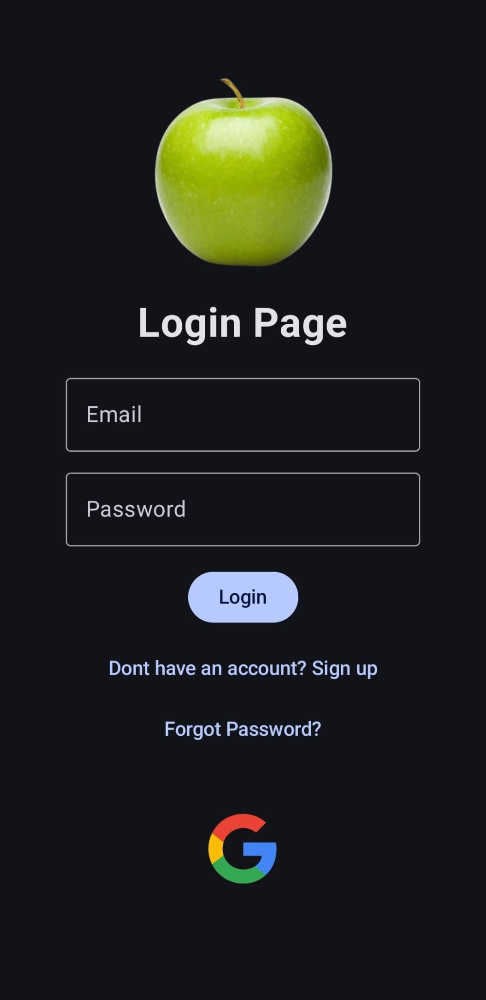
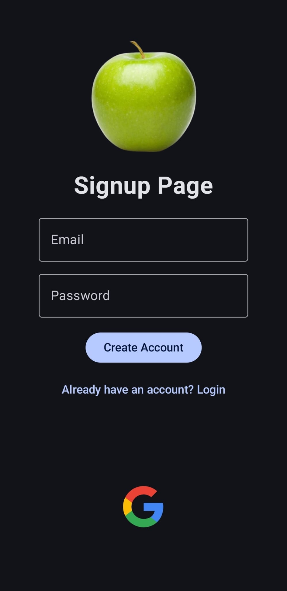
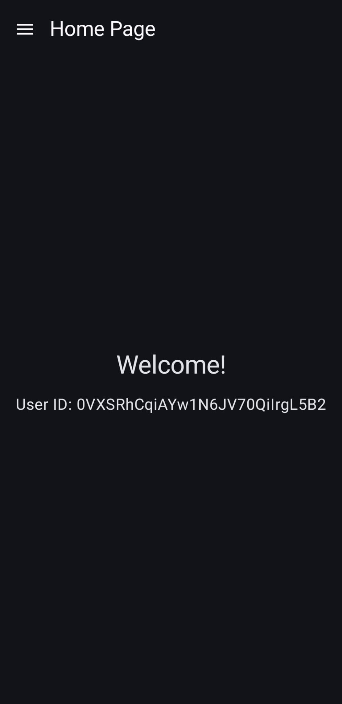
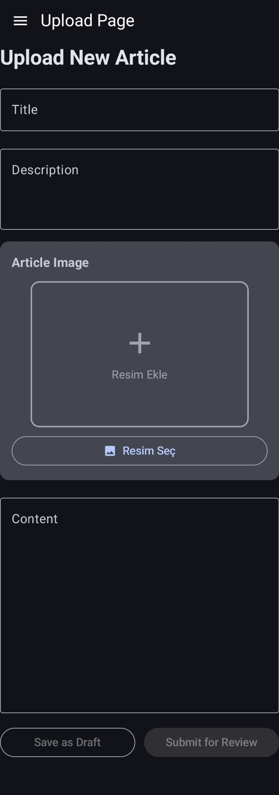
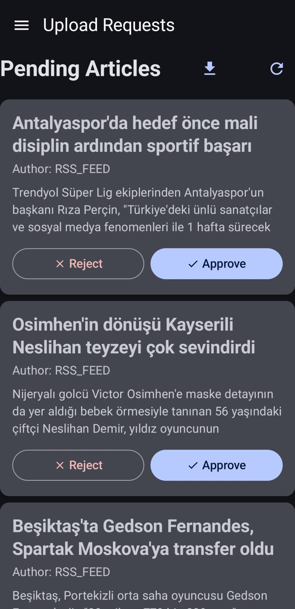
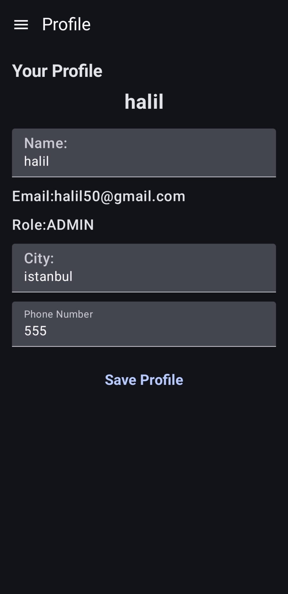
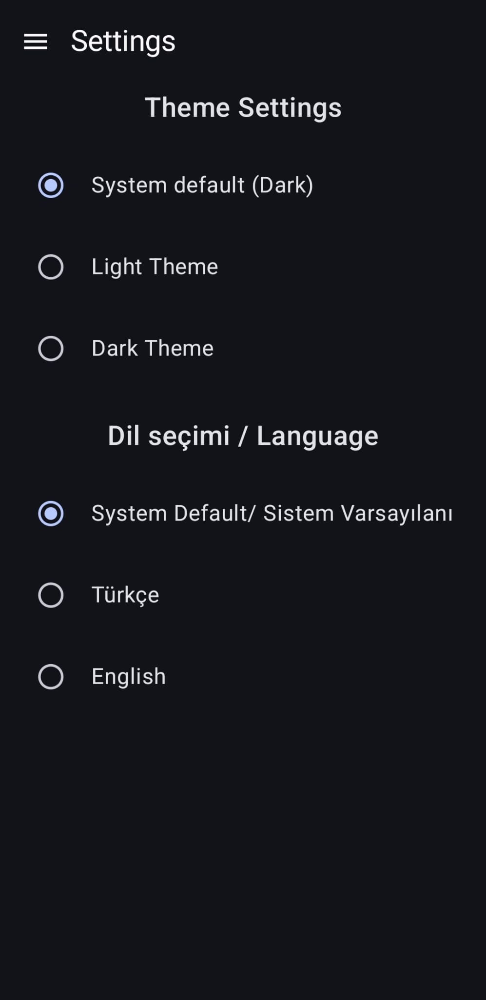

# News Upload App

Bu Android uygulaması, kullanıcıların haberlerini yükleyebildiği, yönetici ve editörlerin bu haberleri inceleyip onaylayabildiği modern bir haber yönetim sistemidir.

## 🚀 Özellikler

### 📝 Kullanıcı Rolleri
- **USER**: Temel kullanıcı (yetki kısıtlı)
- **WRITER**: Haber yazabilir ve yükleyebilir
- **EDITOR**: Haberleri inceleyip onaylayabilir/reddedebilir
- **ADMIN**: Tüm yetkilere sahip

### 🔐 Kimlik Doğrulama
- Email/Şifre ile giriş
- Google ile hızlı giriş
- Şifre sıfırlama özelliği

### 📰 Haber Yönetimi
- **Haber Yazma**: Başlık, açıklama, içerik ve resim ekleyebilme
- **İnceleme Gönderme**: Haberleri onay için gönderebilme
- **Onay Süreci**: Editör/admin onayı ile yayınlama
- **RSS Entegrasyonu**: Otomatik haber çekme özelliği

### 🌍 Çok Dilli Destek
- Türkçe ve İngilizce dil desteği
- Dinamik dil değiştirme

### 🎨 Modern Tasarım
- **Jetpack Compose** ile modern UI
- Koyu/Açık tema desteği
- Responsive tasarım

## 🛠️ Teknolojiler

### Frontend
- **Kotlin** - Ana programlama dili
- **Jetpack Compose** - Modern UI toolkit
- **Navigation Component** - Sayfa geçişleri

### Backend & Veritabanı
- **Firebase Authentication** - Kullanıcı kimlik doğrulama
- **Cloud Firestore** - NoSQL veritabanı
- **Firebase Storage** - Resim/dosya depolama
- **Google Sign-In** - Sosyal medya girişi

### Kütüphaneler
- **Coil** - Resim yükleme
- **JSoup** - RSS/HTML parsing
- **ViewModels & StateFlow** - State yönetimi

## 📱 Ekranlar

1. **Giriş Sayfası** - Email/Google ile giriş

2. **Kayıt Sayfası** - Yeni hesap oluşturma

3. **Ana Sayfa** - Kullanıcı dashboard'ı

4. **Haber Yükleme** - Yeni haber oluşturma

5. **Haber İnceleme** - Editor/admin onay ekranı

6. **Profil Sayfası** - Kullanıcı bilgileri

7. **Ayarlar** - Tema, dil ve diğer ayarlar



## 🔧 Kurulum


### Adımlar
1. Projeyi klonlayın
```bash
git clone https://github.com/halilkaya69/NewsUploadApp.git
```
2. Firebase Console'da yeni proje oluşturun
3. `google-services.json` dosyasını `app/` klasörüne ekleyin
4. Firebase Authentication, Firestore ve Storage'ı aktif edin
5. Projeyi Android Studio'da açın ve çalıştırın

## 📊 Veritabanı Yapısı

### Users Collection
```json
{
  "name": "string",
  "email": "string", 
  "city": "string",
  "role": "USER|WRITER|EDITOR|ADMIN",
  "phoneNumber": "string"
}
```

### Articles Collection
```json
{
  "id": "number",
  "author": "string",
  "title": "string",
  "description": "string",
  "content": "string",
  "urlToImage": "string",
  "status": "DRAFT|PENDING|APPROVED|REJECTED",
  "publishedAt": "timestamp",
  "updatedAt": "timestamp",
  "moderatorId": "string",
  "rejectionReason": "string"
}
```

## 🔐 Güvenlik
- Rol tabanlı erişim kontrolü

